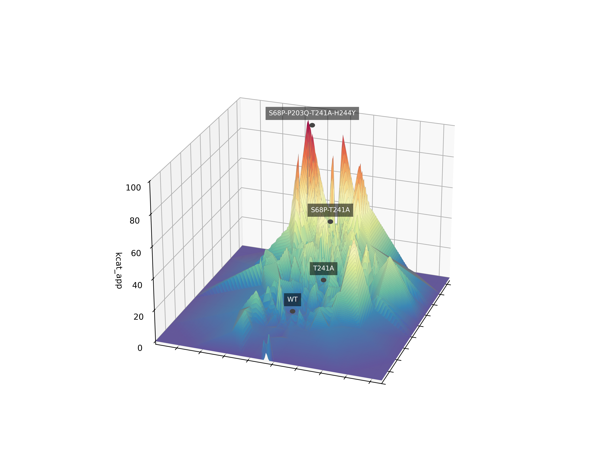

#  Deep sequence-function mapping reveals computationally unpredictable epistatic trajectories that drive laboratory evolution 
(Nintzel #, Lihan #, Penner #, Sieders, Gantz, Bormke, Sifri, Medcalf, Mathis, Cao,  Hollfelder *)

## The study

We carried out a directed evolution campaign on the enzyme biocatalyst SrIRED. We then ran deep sequence-function mapping to map the fitness of every variant that was selected during the campaign. This allows us to retrospectively study how mutations combine and compete, forming the basis for testing design principles for directed evolution campaigns.

We go on to test state-of-the-art methods in mutational effect prediction. We find that while they are generally good at identifying dead from alive enzymes, none effectively rank mutations in the campaign by their relative fitness. Even supervised learning approaches cannot improve prediction beyond random. 

We argue that predicting evolutionary trajectories in enzyme evolution campaigns remains an unsolved problem, and that carrying out retrospective fitness mapping of these campaigns allows the design choices taken in the campaign to be evaluated, to iteratively improve directed evolution success rates over time.

This is the codebase supporting the above manuscript. Here, you will find code to replicate and build on the analysis we carried out, as well as data in various stages of processing.



## Repository structure

```
01_fitness_score_processing/          fitness scores from lrDMS
  01_lrDMS_pipeline/                  raw reads to per-variant counts, via DiMSum
    01_NGS/                           download and merge the Illumina reads
    02_DiMSum_DMS/                    one run per droplet gate, outputs the fitness scores
    03_DiMSum_population_dynamics/    one run per roud of campaign, gives per-round counts
  02a_high_confidence_fitness_scores/ fitness table for the high confidence variants
  02b_low_confidence_fitness_scores/  fitness table for the low confidence variants
  02c_inactive_variants/              table of inactive variants
  03_deriving_kcatapp/                fitting of fitness -> apparent kcat
02_long_read_processing/              nanopore long-read processing
03_analysis/                          scripts to generate figure panels
04_biophysics/                        laboratory measurements on purified variants
repo_paths.py                         shared paths to the datasets
requirements.txt                      pip dependencies
environment.yaml                      conda environment for the analysis scripts
environment-pipeline.yaml             conda environment for the DiMSum pipeline
.project-root                         marker file; scripts find the repo root by it
```

### Environment

To replicate the analyses in this repository, a conda environment with the required packages can be installed:

```bash
git clone https://github.com/michallihan/dETM_srIRED.git
cd dETM_srIRED

conda env create -f environment.yaml
conda activate rike-evo
```

The DiMSum pipeline has its own environment, and is only needed to rerun
`01_fitness_score_processing/01_lrDMS_pipeline`:

```bash
conda env create -f environment-pipeline.yaml
conda activate rike-evo-pipeline
```

Figure 4E scores variants with ESM2, which needs `pytorch` and `fair-esm` on top of the
analysis environment plus the model weights (downloaded on first run).

```bash
conda install -c conda-forge pytorch
pip install fair-esm
```

### Running a script

Each figure panel can be regenerated by simply running the requisite script:

```bash
cd 03_analysis/Figure_3/3AB_epistasis_analysis
python 1_plot_epistasis.py
```

### How scripts find their data

No script uses an absolute path or depends on the directory it is run from. Each anchors
its paths to its own file location, so the repo works wherever it is cloned.

A script working only within its own folder:

```python
from pathlib import Path
THIS_DIR = Path(__file__).resolve().parent
```

A script that also needs a backbone dataset walks up to the repo root, marked by the
`.project-root` file, and imports the shared constants from `repo_paths.py`:

```python
from pathlib import Path
import sys

THIS_DIR = Path(__file__).resolve().parent
REPO_ROOT = THIS_DIR
while not (REPO_ROOT / ".project-root").exists():
    REPO_ROOT = REPO_ROOT.parent
sys.path.insert(0, str(REPO_ROOT))

from repo_paths import FITNESS_HIGH_CONF_CSV
```

 `.project-root` is therefore required — it is how scripts find the repo root.


The constants, grouped as they are in `repo_paths.py`:

| Constant | Points at |
| --- | --- |
| `FITNESS_HIGH_CONF_CSV` | `02a_high_confidence_fitness_scores/final_fitness_scores_ETM.csv` |
| `FITNESS_LOW_CONF_CSV` | `02b_low_confidence_fitness_scores/final_fitness_scores_ETM.csv` |
| `INACTIVE_VARIANTS_CSV` | `02c_inactive_variants/inactive_variants.csv` |
| `FITNESS_HIGH_CONF_KCAT_CSV` | high-confidence table with modelled apparent kcat joined on |
| `KCAT_APP_FIT_JSON` | fitted parameters of the fitness-to-kcat conversion |
| `LRDMS_SINGLE_MUTANTS_CSV` | single mutants carried over from the lrDMS paper |
| `DIMSUM_DMS_{LENIENT,STRINGENT}_CSV` | per-gate scored variants |
| `DIMSUM_DMS_{LENIENT,STRINGENT}_MERGE_TSV` | per-gate counts before the fitness stage |
| `DIMSUM_ROUND_COUNTS_TSV` | per-round counts, keyed by round |
| `DIMSUM_NAIVE_COUNTS_XLSX` | round 0 counts |
| `COLLAPSED_UNIQUE_VARIANTS_CSV` | nanopore variant dictionary |
| `BIOPHYSICAL_DATA_CSV` | purified-variant measurements |
| `ALTERNATIVE_PATHS_KINETICS_CSV` | kinetics of the alternative-path variants |
